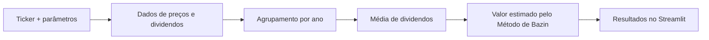

# BazinBot

Aplicativo de valuation educacional de ações brasileiras pelo Método de Bazin, desenvolvido como trabalho aplicado da pós-graduação em Ciência de Dados para Mercado Financeiro com IA (XP Educação).

**[▶ Experimentar aplicativo](https://bazinbot.onrender.com/)** · **Python** · **Pandas** · **Streamlit** · **Finanças quantitativas**


### Visão rápida

| Entrada | Processamento | Resultado |
|---|---|---|
| Ticker, taxa de retorno e período | Consulta de preços/dividendos e média anual de dividendos | Estimativa de valor, dividend yield e tabela anual |



> **Demonstração online:** o cálculo é didático e simplificado, não representa recomendação de investimento. A disponibilidade dos dados depende do Yahoo Finance.

## Objetivo

Automatizar a consulta de preços e dividendos e apresentar uma estimativa de valor baseada na média histórica de dividendos e na taxa de retorno definida pelo usuário. O projeto reúne coleta de dados, tratamento de séries temporais e desenvolvimento de uma aplicação web em Python.

## Funcionalidades

- Consulta de ações brasileiras pelo ticker.
- Obtenção do último fechamento disponível e do histórico de dividendos.
- Cálculo da média anual de dividendos e do valor intrínseco estimado.
- Exibição do Dividend Yield baseado na média histórica e da diferença percentual entre o valor estimado e o preço.
- Tabela com os dividendos anuais utilizados no cálculo.

## Tecnologias

`Python` • `Pandas` • `yfinance` • `Streamlit` • `Git` • `GitHub` • `Render`

Os dados são obtidos do Yahoo Finance por meio da biblioteca `yfinance`.

## Como usar

1. Acesse o [aplicativo](https://bazinbot.onrender.com/).
2. Informe o ticker de uma ação brasileira, por exemplo, `PETR4`.
3. Defina a taxa de retorno desejada, em percentual, e os anos de histórico.
4. Clique em **Calcular** e consulte os resultados e a tabela de dividendos.

## Como o cálculo é feito

Os dividendos do período selecionado são agrupados por ano-calendário. A média dos totais anuais selecionados é dividida pela taxa de retorno, convertida para a forma decimal:

```text
Valor intrínseco estimado = média anual de dividendos / (taxa de retorno (%) / 100)
```

O Dividend Yield exibido utiliza essa mesma média histórica e o último fechamento disponível. A média pode incluir o ano em andamento, com dividendos ainda parciais.

## Executar localmente

Em um ambiente Python, dentro da pasta do projeto:

```bash
python -m pip install -r requirements.txt
python -m streamlit run app.py
```

O arquivo de entrada da aplicação publicada é `app.py`. As dependências estão em `requirements.txt`, e `render.yaml` contém a configuração de referência para hospedagem no Render.

## Publicação

A aplicação está hospedada no Render e vinculada à branch `main` deste repositório. Atualizações de código nessa branch são publicadas automaticamente.

## Limitações

- A estimativa é simplificada e depende do histórico de dividendos disponível.
- O preço utilizado corresponde ao último fechamento retornado pela fonte.
- A disponibilidade dos dados depende do Yahoo Finance, que pode aplicar limites temporários de consultas.

Projeto acadêmico para fins educacionais. Os resultados não constituem recomendação de investimento.

**Autor:** Álvaro Bonifácio
